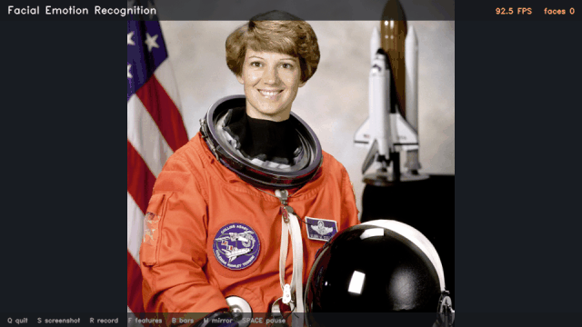
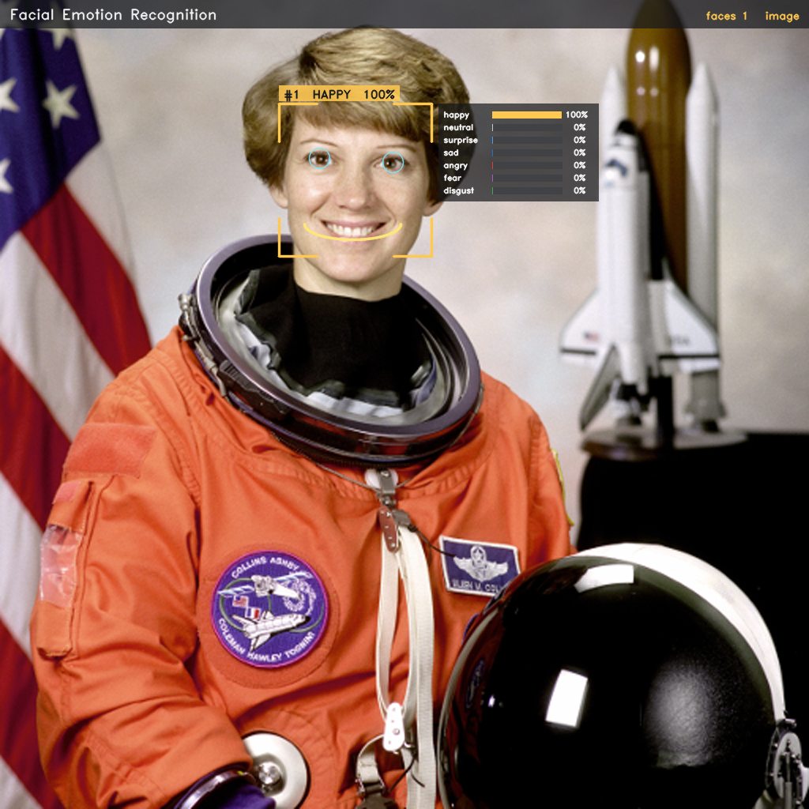
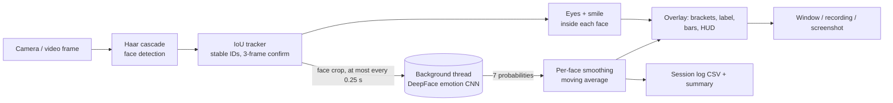

<div align="center">

# Facial Feature & Emotion Recognition

**Real-time, multi-face emotion recognition with OpenCV and DeepFace: smooth, tracked, and fully offline.**


[](https://github.com/iKrazy69/OpenCV-facial-feature-emotion-recognition/actions/workflows/tests.yml)



</div>

## Features

- **Multi-face tracking.** Every face gets a stable ID (`#1`, `#2`, ...) that follows it across frames, so each person's emotion is tracked separately.
- **Seven emotions with live confidence bars.** Happy, neutral, surprise, sad, angry, fear and disgust, shown as a probability panel next to each face.
- **No flicker.** Readings are smoothed over time per face, so the label changes when the expression changes, not when the lighting does.
- **Smooth video.** The emotion model runs on a background thread. Face detection, tracking and drawing stay at full frame rate, and the camera opens instantly while the model loads.
- **Facial features.** Eyes and smile are located inside each face and marked on screen (toggle with `F`).
- **False-detection filter.** A face must be seen in 3 frames in a row before it is shown or analysed, which removes the brief phantom faces Haar cascades produce.
- **Webcam, video file or image.** Record annotated video, take screenshots, and save a CSV log of every reading with a summary at the end.
- **Fully offline.** Nothing leaves the computer after the one-time model download.

<p align="center"></p>

## How it works



1. **Detect.** OpenCV's Haar cascade finds frontal faces in each frame.
2. **Track.** Detections are matched to the previous frame by box overlap (IoU). New faces must survive 3 consecutive frames before they count.
3. **Analyse.** Face crops go to a worker thread that runs DeepFace's emotion model on the latest crop of each face, at most every `--interval` seconds per face.
4. **Smooth.** Each face's seven probabilities are blended with its previous ones (exponential moving average).
5. **Draw.** Corner brackets in the emotion's colour, a label with confidence, the probability panel, eye and smile markers, and a HUD with FPS and face count.

Measured on an Apple M4 laptop: detection, tracking and drawing run at about **89 FPS** on 960×540 video, and the emotion model takes about **2 ms per face**.

## Quick start

```bash
git clone https://github.com/iKrazy69/OpenCV-facial-feature-emotion-recognition.git
cd OpenCV-facial-feature-emotion-recognition
python3 -m venv venv
source venv/bin/activate
pip install -r requirements.txt
python -m emotion_recognition
```

On Windows, activate with `venv\Scripts\activate`. The first start downloads DeepFace's emotion weights (about 6 MB). On macOS, allow camera access for your terminal when asked.

## Controls

| Key | Action |
|---|---|
| `Q` / `Esc` | Quit and print the session summary |
| `S` | Save a screenshot |
| `R` | Start / stop recording the annotated video |
| `F` | Show / hide eye and smile markers |
| `B` | Show / hide the probability bars |
| `M` | Mirror the webcam picture on / off |
| `Space` | Pause |

## Options

```bash
python -m emotion_recognition --source 1
python -m emotion_recognition --source clip.mp4
python -m emotion_recognition --image photo.jpg --out annotated.png
python -m emotion_recognition --log session.csv --record session.mp4
```

| Option | Default | What it does |
|---|---|---|
| `--source` | `0` | Webcam index or video file |
| `--image` / `--out` | | Analyse one image, optionally save the result |
| `--interval` | `0.25` | Seconds between emotion readings of the same face |
| `--min-face` | `60` | Smallest face to detect, in pixels |
| `--no-features`, `--no-bars`, `--no-mirror` | | Start with these overlays off |
| `--record FILE.mp4` | | Record from the first frame |
| `--log FILE.csv` | | Save every reading: time, face ID, emotion, confidence and all seven probabilities |
| `--output-dir` | `captures` | Where screenshots and recordings go |

When the app closes it prints a summary of the session, for example:

```
Session: 5 readings, 1 face(s), 4 s
  happy     ############################## 100.0%
```

## Project structure

```
emotion_recognition/
  faces.py      face, eye and smile detection (Haar cascades)
  tracker.py    IoU tracker with stable IDs and 3-frame confirmation
  emotions.py   DeepFace wrapper, per-face smoothing, background worker
  overlay.py    brackets, labels, probability bars, HUD
  session.py    CSV log and end-of-session summary
  app.py        live pipeline (webcam / video) and image mode
  cli.py        command-line options
examples/       the first single-file prototypes
scripts/        make_demo.py rebuilds the images in docs/
tests/          unit and end-to-end tests
```

## Tests

```bash
python -m unittest discover -s tests -t . -v
```

20 tests cover the tracker, smoothing, background worker, drawing at several resolutions, the session log, the command line, and an end-to-end run on a real photo. They need no webcam. The DeepFace test is skipped automatically when the model is not installed, and GitHub Actions runs the rest on every push.

## Limits

- Haar cascades find mostly frontal, well-lit faces. Strong side views or very dark scenes may be missed.
- The emotion model reads facial *expressions*, not feelings, and works best on clear, front-facing faces.
- Emotion recognition should not be used to make decisions about people.

## Credits

- [OpenCV](https://opencv.org/) for capture, Haar cascades and drawing.
- [DeepFace](https://github.com/serengil/deepface) by Sefik Ilkin Serengil for the facial-expression model.
- The demo and test photo is the public-domain NASA portrait distributed with [scikit-image](https://scikit-image.org/) as `astronaut`.

Built by **Moksh Kumar**.
